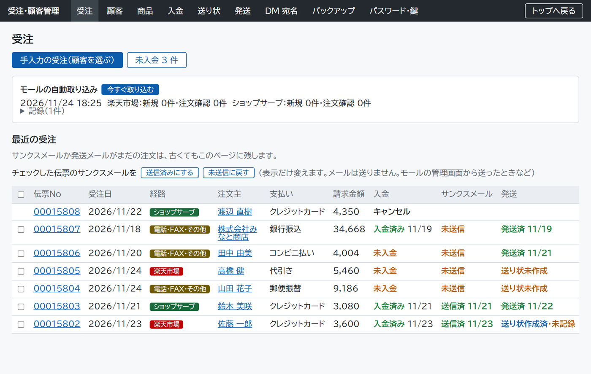
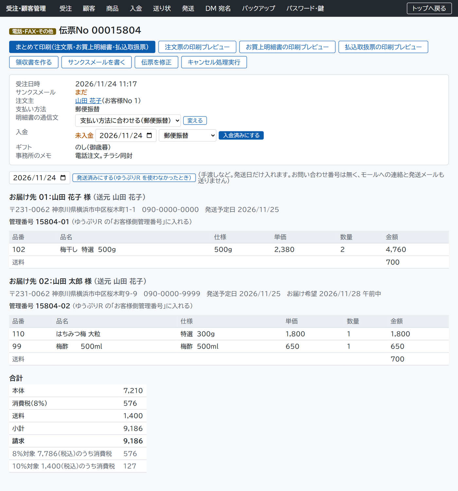
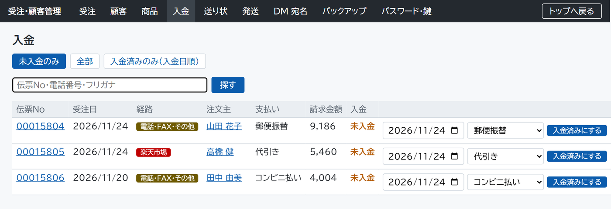
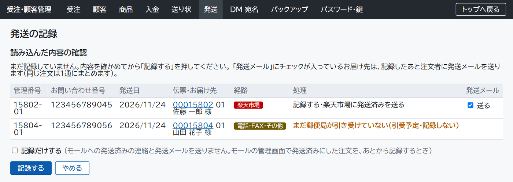
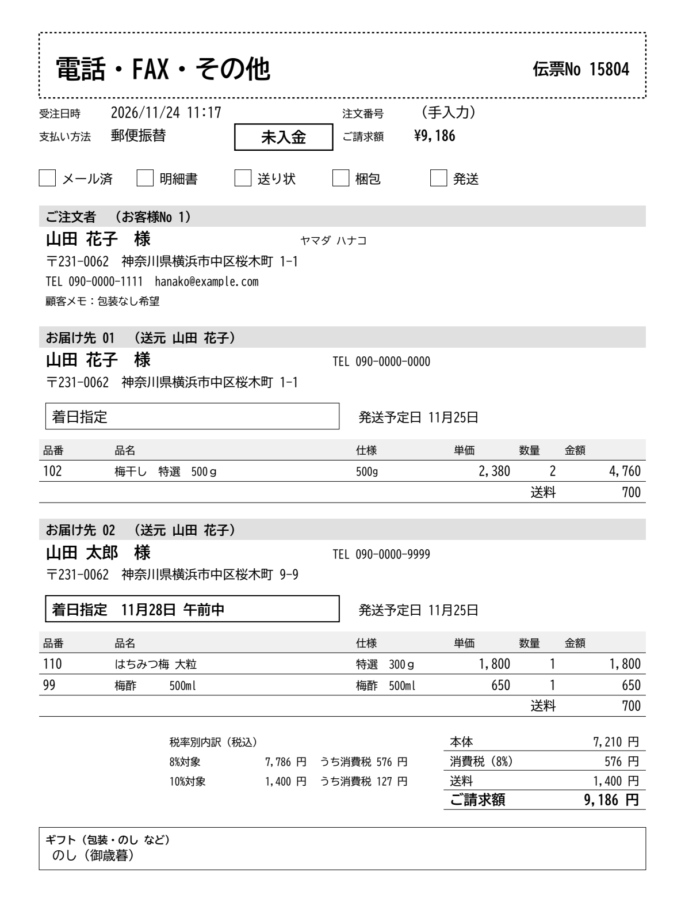
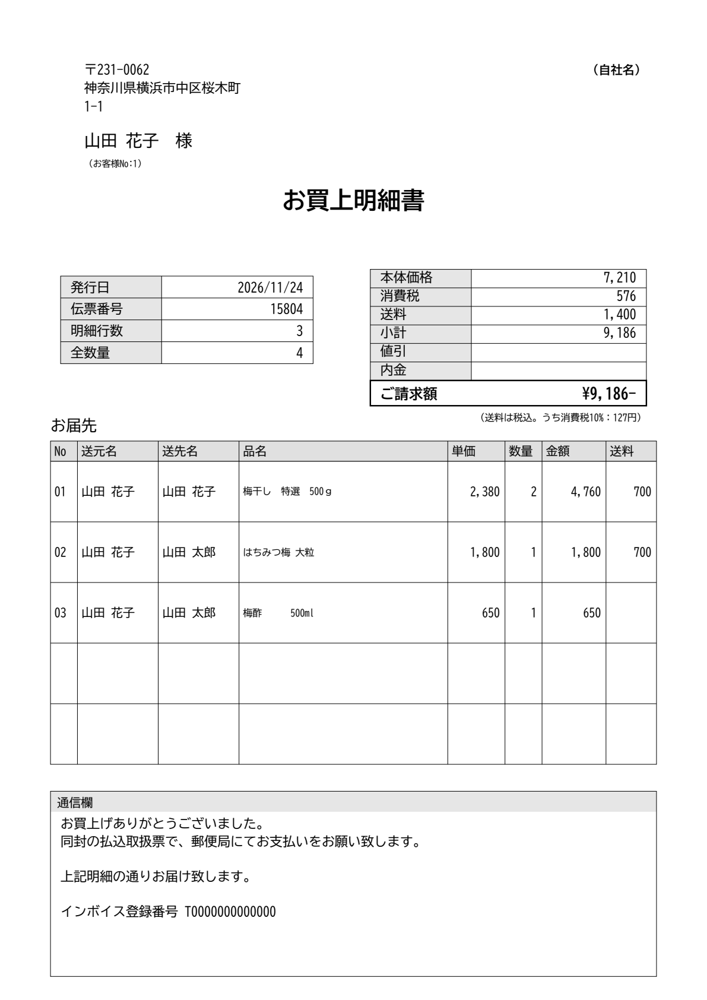

# EC受注・顧客管理システム（食品のネット通販会社向け・稼働中）

食品のネット通販会社のために開発し、**2026年11月から毎日の業務で使われている**受注・顧客管理システムです。
楽天市場とショップサーブの注文を API で自動的に取り込み、顧客・入金・帳票の印刷・発送の連絡までを1つの画面で扱えます。

> **ソースコードは非公開です。** お客様の業務システムのため、このリポジトリでは設計と機能を紹介しています。
> 画面と帳票の画像は、すべて**架空の店名・顧客・注文**で撮ったものです。

---

## 解決した業務課題

| Before（手作業） | After（このシステム） |
| --- | --- |
| モールの注文メールを印刷し、古い販売管理ソフトに**手で打ち直していた** | 楽天 RMS・ショップサーブの**受注 API から5〜10分おきに自動で取り込み**、注文確認もモールに書き戻す |
| 楽天とショップサーブで書式が違い、どのモールの注文か見分けにくい | 注文票を共通の書式にし、**モールごとに帯の形を変えて白黒印刷でも一目でわかる**ように |
| 入金の確認（代引き・コンビニ払い・郵便振替・後払い）を1件ずつ見ていた | **未入金の一覧**と入金の記録。モール側で入金済みになった注文は自動で反映 |
| 送り状ソフト（ゆうぷりR）に宛先を打ち直し、発送後にモールの管理画面で1件ずつ発送連絡 | 送り状ソフト用の CSV を書き出し、**お問い合わせ番号を読み込むと、モールへの発送連絡とお客様への発送メールまで自動** |
| 明細書・払込取扱票・領収書を別々のソフトや Excel で作っていた | すべて**このシステムから PDF で原寸印刷**（専用用紙への位置合わせつき） |

約14年分の古いシステムの顧客・注文データも移行し、リピーターの購入履歴を引き継いでいます。

---

## 画面

**受注の一覧**：モールの自動取り込みの状況と、入金・サンクスメール・発送の進み具合がひと目でわかります。



**伝票の画面**：ギフトの複数お届け先、のし、お届け希望日、税率別（8%／10%）の内訳に対応しています。



**入金**：未入金だけを表示し、その場で入金済みにできます。



**発送の記録**：送り状ソフトの発送データを読み込むと、まず確認画面を出します。郵便局がまだ引き受けていない荷物は記録しません。



| 注文票（A4） | お買上明細書（A4・商品に同封） |
| --- | --- |
|  |  |

---

## 主な機能

- **受注の自動取り込み**：楽天 RMS 受注 API・ショップサーブ受注 API。注文番号で二重登録を防止。取り込めなかったときは画面で知らせる
- **モールへの書き戻し**：注文確認・発送完了の連絡（両モール）、キャンセル（楽天市場）
- **手入力の受注**：電話・FAX の注文。郵便番号から住所を自動入力（日本郵便の郵便番号データ・オフライン）
- **顧客管理**：購入履歴・メモ・DM の送付可否。古いシステムからのデータ移行
- **入金管理**：代引き・コンビニ払い・郵便振替・銀行振込・後払い。モール側の入金状態を自動で反映
- **帳票の PDF 印刷**：注文票、お買上明細書、払込取扱票、コンビニ払込票（バーコード付き）、領収書（収入印紙の枠の判定つき）、法人向けの納品書、DM 用の宛名シール（A4 24面）
- **消費税**：税込・税抜の注文、8%（食品）と 10%（送料など）の税率別内訳
- **発送**：送り状ソフト用 CSV の書き出し → 発送データの読み込み → モールへの発送連絡とお客様への発送メール（SMTP）
- **サンクスメール**：経路ごとのテンプレートから下書きを作成
- **運用**：起動時の自動起動、データのバックアップ、楽天 API キーの期限が近づいたらメールで通知、Windows 用の実行ファイル

---

## 構成

```
[楽天 RMS 受注 API] ─┐                         ┌─► 帳票 PDF（ReportLab）─► プリンタ（原寸印刷）
                     ├─► 自動取り込み ─► SQLite ─┼─► 送り状ソフト用 CSV
[ショップサーブ API] ─┘   （5〜10分おき）  （SQLAlchemy）└─► 発送連絡（モール API）・発送メール（SMTP）
                                       ▲
                     ブラウザ画面（FastAPI＋Jinja2・事務所の PC の中だけで待ち受け）
```

- 事務所の Windows パソコン1台で動かし、画面は `127.0.0.1` だけで待ち受けます
- 顧客の個人情報は**外部のクラウドや AI へ送りません**。データベースと API の鍵はパソコンの中だけに置き、Git には入れていません

---

## 技術

| 分類 | 使用技術 |
| --- | --- |
| 言語 | Python 3.13 |
| Web | FastAPI、Jinja2、Uvicorn |
| DB | SQLite、SQLAlchemy 2.0 |
| 帳票 | ReportLab（PDF）、SumatraPDF（原寸印刷） |
| 外部連携 | 楽天 RMS 受注 API、ショップサーブ受注 API、SMTP |
| テスト | pytest（259件。金額・税率の計算、帳票、取り込み、発送の記録など） |
| 規模 | 約10,000行（2026年10月に開発開始 → 11月に本番切り替え） |

---

## 開発の進め方

- 現場の業務（古いソフトの画面・紙の帳票・送り状ソフトの仕様）を確認し、置き換える範囲と残す範囲を決めてから実装しました
- 実際の注文で、取り込みからキャンセル・発送連絡までを1つずつ確認してから本番に切り替えました
- 本番切り替え後も、使う人の要望（税率別の内訳、領収書、納品書、発送メールなど）を聞きながら毎週改善しています
- 要件の整理から実装・テスト・マニュアル作成まで、**Claude Code** を使って進めています

---

作成：株式会社Affect（横浜）
